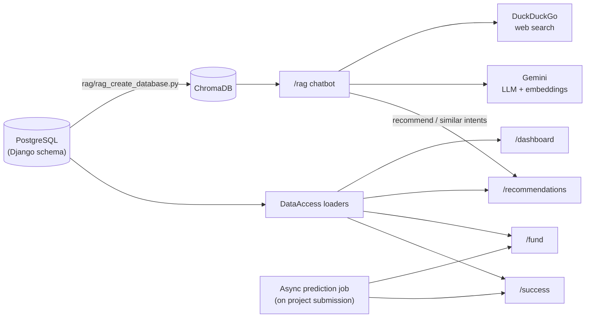

# Investo — AI & ML Module

AI/ML backend for my graduation project **Investo**, a digital investment platform that connects SME entrepreneurs (Egypt-focused) with investors. It scores startups, predicts funding, recommends startups to investors, serves analytics, and answers investor questions through a RAG chatbot.

## Features

| Component | What it does | Core tech |
|---|---|---|
| **Success score model** | Predicts startup potential on a 1–9 scale | scikit-learn pipeline, Random Forest, SHAP |
| **Funding model** | Predicts total funding ($M) | Same pipeline design |
| **Recommender** | Ranked startup matches per investor, cold-start safe | Implicit ALS + cosine similarity |
| **Dashboards** | Startup, investor, market, and risk analytics | pandas |
| **RAG chatbot** | Natural-language Q&A routed to RAG, recommender, or web search | LangChain, ChromaDB, Gemini |

## Architecture



On project submission, a background job computes graph features (community, centralities), then calls the success and funding APIs and stores the results on the project.

## How it works

### Success & funding models
- **Pipeline:** `ColumnTransformer` with mean-impute + `StandardScaler` (numeric), most-frequent-impute + `OneHotEncoder(drop='first', handle_unknown='ignore')` (categorical), and a custom `MultiLabelBinarizerTransformer` for `tech_stack`. The fitted binarizer lives inside the saved pipeline, so there is no separate artifact.
- **Selection:** Linear, Lasso, Ridge, and Random Forest compared with 5-fold `GridSearchCV` (R²). Random Forest wins. SHAP validates feature contributions.
- **Leakage control:** `ipo`, `acquired`, `valuation`, `risk_level` are excluded from both models. The funding model also drops `annual_revenue`, `customer_base`, and `success_score`.
- **Graph features:** `community_id`, degree centrality, and betweenness centrality are model inputs.
- **Outputs:** success is clipped to 1–9. Funding is floored at 0.1 ($M) with no upper cap.
- **Results:** R² **0.82** (success) and **0.79** (funding) on a held-out 20% split of a synthetic dataset (5,000 startups, 500 investors).

### Recommender
- **Content-based:** 10-feature vectors for startups and investors, scaled to 0–1. Investor dimensions with no startup equivalent are padded with 0.5. The investment midpoint uses the startup funding scaler so both sides share an axis.
- **Collaborative:** Implicit ALS (50 factors, regularization 0.01, 30 iterations) on a binary matrix of approved investments.
- **Blend:** `final = 0.95 × ALS + 0.05 × content`. Investors with no history get `final = content`.
- **Hard filters:** already-invested startups and startups outside the investor's min/max investment range are excluded.
- **Similar startups:** item-to-item cosine similarity with case-insensitive name lookup.
- Models are built lazily on the first request, so the service starts fast and the router always registers.

### RAG chatbot
- **Indexing:** public columns only, in four document types (startup profiles, investor preferences, industry/country summaries, portfolio histories). Chunked at 500 characters with 100 overlap and stored in ChromaDB.
- **Routing:** keyword heuristics with an LLM fallback pick one of three intents: `rag`, `recommend_startups`, `similar_startups`. The last two call the recommender API directly, so recommendation lists are never LLM-generated.
- **Retrieval:** top 5 chunks, relevance ≥ 0.5. Investor and portfolio chunks are only visible to their owner (`investor_id` filter).
- **Web search:** DuckDuckGo runs for general and macroeconomic questions (interest rates, inflation, GDP, exchange rates).
- **Generation:** Gemini 2.5 Flash-Lite at temperature 0.2 with the last 10 turns. History is held by the client, so the server is stateless. Rate-limit (429) errors return a friendly retry message.

### Dashboards
- **Startup performance:** revenue per employee, funding efficiency, valuation multiple, traction score, industry percentile.
- **Investor portfolio:** industry/stage/country mix, average success score, capital allocation, network centrality.
- **Market intelligence:** success rates by industry and country, performance by funding stage, funding vs. valuation sample, distribution counts. *This is the dashboard wired into the current frontend.*
- **Risk insights:** failure rate by stage, funding quartile, and industry; survival by age band.
- Success is defined as score ≥ 7 and failure as score ≤ 4. Data is loaded once and cached.

## API reference

| Method | Endpoint | Description |
|---|---|---|
| POST | `/success/predict` | Success score (raw + rounded 1–9) |
| POST | `/fund/predict` | Total funding prediction ($M) |
| POST | `/recommendations/investor-to-projects` | Top startup matches for an investor |
| POST | `/recommendations/similar-startups` | Startups most similar to a given one |
| POST | `/rag/chat` | Chatbot with history and sources |
| POST | `/dashboard/startup` | Startup performance metrics |
| POST | `/dashboard/investor` | Investor portfolio metrics |
| GET | `/dashboard/market` | Market intelligence metrics |
| GET | `/dashboard/risk` | Risk insight metrics |
| GET | `/success/`, `/fund/`, `/recommendations/`, `/rag/`, `/dashboard/` | Health checks |

## Tech stack

- **Language:** Python 3.11
- **ML & data:** scikit-learn, pandas, NumPy, SciPy, implicit, SHAP, joblib
- **API & data access:** FastAPI, Pydantic, SQLAlchemy, psycopg2
- **AI / RAG:** LangChain, ChromaDB, Gemini (LLM + embeddings), DuckDuckGo Search
- **Database:** PostgreSQL
- **Deployment:** Docker, Uvicorn

## Project layout

```
├── Success Model/
│   ├── success_model.py          # training
│   └── success_api.py            # serving
├── Fund Model/
│   ├── fund_model.py
│   └── fund_api.py
├── Recommendeation System/
│   ├── recommender_system.py     # content + ALS + hybrid scoring
│   └── recommender_system_api.py
├── Automated Dashboards/
│   ├── dashboards.py             # metric computation
│   └── dashboards_api.py
└── RAG/
    ├── rag_create_database.py    # indexing
    ├── rag_query_data.py         # routing, retrieval, generation
    └── rag_chatbot_api.py
```

## 🖥️ Snapshots

<p align="center">
  
  
  
  
  
  
  
  
  
  
</p>
